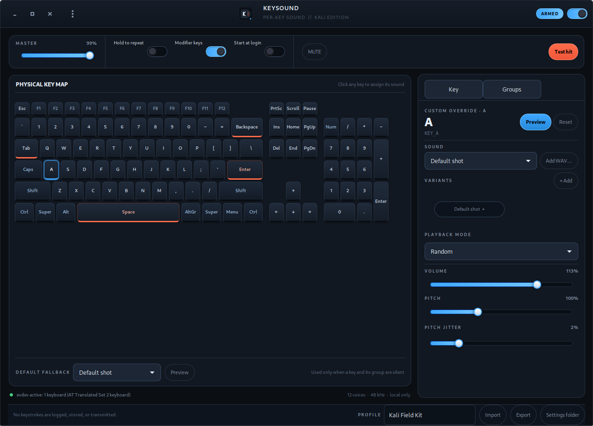

# KeySound — per-key keyboard sounds for Kali Linux

KeySound is a native Kali Linux desktop application that listens to physical key
events system-wide and plays a different, user-assigned sound for each key. It
runs in the system tray, stores its settings locally, and never logs, stores, or
transmits the keys you press.

This is a Linux-only project built for Kali. There is intentionally no Windows
or macOS build. It is also not a copy of ShotgunKeyboard: the reference product
plays one sound for every key, while KeySound adds per-key mapping, groups,
variants, pitch/volume controls, and profile bundles.



## Highlights

- **Per-key sounds** for a physical 104-key layout, with a clickable visual
  keyboard editor.
- **Group fallbacks** (letters, digits, punctuation, modifiers, function keys,
  navigation, numpad, controls, media) so a whole category can share a sound.
- **Per-key and per-group** volume (0–150 %), pitch (50–200 %), pitch jitter,
  and single/random/round-robin variant playback.
- **12-voice polyphony** with low-latency 48 kHz mono mixing.
- **evdev primary backend** (`/dev/input/event*`) with hot-plug support, and an
  **automatic XInput2 fallback** on X11 when evdev permission is unavailable.
- **Tray indicator** with arm, mute, autostart, input status, and quit actions.
- **Global mute chord** `Ctrl+Alt+Shift+M`, detected from the key stream so it
  also works on Wayland once evdev access is available.
- **Optional hold-to-repeat**, modifier-key sounds, and launch-at-login.
- **Profiles** exported as self-contained `.keysound` bundles, including custom
  WAV files.
- **Privacy first**: key codes are used to pick a sound and then discarded.

## Requirements

- Kali Linux (or another Debian-based distribution with GTK 3).
- Python 3.10 or newer.
- PyGObject (`python3-gi`), GTK 3, numpy.
- Ayatana AppIndicator for the tray (`gir1.2-ayatanaappindicator3-0.1`).
- PulseAudio, or PipeWire with its PulseAudio compatibility layer
  (`libpulse0`).
- On Wayland, read access to `/dev/input/event*` (membership in the `input`
  group). On X11, KeySound can use XInput2 without that access.

## Quick start from this checkout

```bash
cd /home/hicham/Desktop/projects/shotgunkeyboard
python3 -m keysound
```

That is enough on this Kali X11 desktop: XInput2 is used automatically while
the user is not in the `input` group. The window shows an input banner until
evdev access is enabled.

For the recommended Wayland-ready backend, run the setup helper once:

```bash
sudo ./scripts/setup-kali.sh
# log out of the desktop and back in (or reboot)
python3 -m keysound
```

The helper installs the runtime packages and adds your user to the `input`
group. It does not install KeySound itself.

Check the environment without capturing keystrokes:

```bash
python3 -m keysound --diagnose
python3 -m keysound --version
```

## Installation from a .deb

Build the package:

```bash
./packaging/build-deb.sh
sudo apt-get install -y ./dist/keysound_1.0.0_all.deb
```

Then run `keysound` from the application menu or a terminal. The package
installs:

| Path | Purpose |
| --- | --- |
| `/usr/bin/keysound` | launcher |
| `/usr/lib/keysound/` | Python package, assets, sounds |
| `/usr/share/applications/keysound.desktop` | menu entry |
| `/usr/share/icons/hicolor/…/apps/keysound.png` | icons |
| `/usr/share/keysound/setup-kali.sh` | input-group setup helper |
| `/usr/share/doc/keysound/` | README, report, licence |

The `.deb` deliberately does **not** add you to the `input` group in a
post-install script. Group membership grants read access to every input device,
so it is left as an explicit, informed step:

```bash
sudo /usr/share/keysound/setup-kali.sh
```

A thin AppImage build script is also included:

```bash
APPIMAGETOOL=/path/to/appimagetool ./packaging/build-appimage.sh
```

It bundles the application code but uses the system Python/GTK stack. The
Debian package is the recommended distribution format.

## Using KeySound

### Main window

- **Power switch / Armed badge** — arm or silence all sounds.
- **Master volume** — 10–100 %.
- **Hold to repeat** — play while a key is held (off by default).
- **Modifier keys** — include Shift, Ctrl, Alt, and Super.
- **Start at login** — writes `~/.config/autostart/keysound.desktop`.
- **Mute** — silence everything without disarming. The global chord
  `Ctrl+Alt+Shift+M` toggles the same state.
- **Test hit** — preview the selected key.
- **Physical key map** — click a keycap to edit it. Keys with a custom
  override get an orange underline.
- **Default fallback** — sound used when neither the key nor its group has an
  enabled assignment.
- **Profile bar** — rename the profile, import/export `.keysound` bundles, open
  the settings folder.

### Key inspector

- Choose a sound, then optionally add more variants.
- Playback mode: **Single**, **Random**, or **Round robin**.
- Volume, pitch, and pitch jitter are applied immediately and saved.
- **Preview** auditions the current settings.
- Choosing **Use fallback (…)** clears the per-key override.
- The **Reset** button appears only when the key has an override.

### Group inspector

Switch to the **Groups** tab to edit the fallback for a whole key group. Group
rules apply to every key in that group that does not have its own override.

### Profiles

- **Export** writes a `.keysound` ZIP containing `profile.json`, a manifest, and
  any custom WAVs used by the profile.
- **Import** merges the profile, restores its custom sounds into
  `~/.local/share/keysound/sounds/`, and keeps your autostart preference.
- Profile import is validated: paths, sound names, modes, and numeric ranges are
  sanitized.

### Tray

The Ayatana/StatusNotifier indicator provides: Open, Armed, Mute, Start at
login, Test sound, Input status, and Quit. Closing the window hides it to the
tray when the indicator is available.

## Settings and files

KeySound follows the XDG base-directory spec:

| Path | Contents |
| --- | --- |
| `~/.config/keysound/settings.json` | settings and assignments (mode 0600) |
| `~/.config/keysound/profiles/` | reserved for profile storage |
| `~/.local/share/keysound/sounds/` | imported WAV files |
| `~/.cache/keysound/` | cache directory |
| `~/.config/autostart/keysound.desktop` | autostart entry when enabled |

The settings file contains **assignments**, not a key history. It stores sound
filenames, volume/pitch/jitter values, group rules, the profile name, the
default fallback, and UI preferences. A corrupt settings file is backed up as
`settings.json.corrupt` and replaced with defaults instead of preventing
startup.

Example (truncated):

```json
{
  "version": 1,
  "profileName": "Kali Field Kit",
  "masterVolume": 0.8,
  "defaultSound": "default.wav",
  "groups": {
    "letters": {
      "sounds": ["default.wav"],
      "mode": "single",
      "volume": 1.0,
      "pitch": 1.0,
      "jitter": 0.0,
      "enabled": true
    }
  },
  "keys": {
    "KEY_SPACE": {"sounds": ["shotgun.wav"], "mode": "single", "volume": 1.0,
                  "pitch": 1.0, "jitter": 0.008, "enabled": true}
  }
}
```

## Sounds

The shipped set is an **arsenal weapon pack** (12 sounds: default shot,
shotgun, bomb, sniper click, mag drop, digits burst, rifles, machine gun,
artillery, tank cannon, plus a legacy key-up tick), provided by the user.
`manifest.json` next to the WAVs lists every file with its label, description,
source, author and licence (`unknown` where not confirmed); only files listed
there are shown in the UI. See `keysound/assets/sounds/CREDITS.md` for the full
attribution table.

- Categories ship with **`default.wav` for all of them**: until you assign
  something, every key — letters, digits, modifiers, everything — plays the
  default shot. Per-key and per-category assignments are opt-in.
- The decoded length cap is 3 seconds, so the longer cannon shots survive.
- If `defaultSound` or an assignment points at a deleted file, playback falls
  back to `default.wav` instead of going silent.

The legacy synthesized "high clicky" set can still be regenerated into this
folder from `tools/generate_sounds.py`, but the script **refuses to write**
unless you pass `--write`, because it would overwrite the weapon samples:

```bash
python3 tools/generate_sounds.py --write   # legacy clicky set (overwrites!)
```

You can add your own sounds in two places:

- **Add WAV…** next to the sound selector in both the Key and Groups
  inspectors. The file is validated, copied to your personal library, and
  assigned to the key/category you are editing in one step.
- **Menu → My sounds…** shows the library with a preview and a remove button,
  plus its own Add sound… button.

Only PCM WAV is accepted (8/16/24/32-bit, mono or stereo; resampled to
48 kHz). Files are stored under `~/.local/share/keysound/sounds/` with a
`custom-` prefix and survive restarts. Name collisions get `-2`, `-3`, …
suffixes instead of overwriting. Removing a sound also removes it from any
key/category that referenced it, falling back to `default.wav`.

## Privacy

- The listener converts a physical key code to a `KEY_*` identifier, selects a
  rule, and plays it.
- Key codes, characters, timestamps, and typing sequences are **not written to
  disk and not sent over the network**.
- There is no analytics, telemetry, account, or network client in the
  application.
- The diagnostic command (`--diagnose`) reports only environment facts such as
  sound count, backend permission, and audio status.
- Settings and profiles are readable only by your user (0600 for the settings
  file; the config directories are created with 0700 where possible).
- The `input` group itself is powerful: any program you run with that
  membership can read keyboards. Only enable it on a machine you trust.

## Command line

```bash
python3 -m keysound                 # start normally
python3 -m keysound --minimized     # start hidden in the tray
python3 -m keysound --no-tray       # run without the indicator
python3 -m keysound --diagnose      # JSON environment report
python3 -m keysound --verbose       # debug logging
python3 -m keysound --version
```

When installed, replace `python3 -m keysound` with `keysound`.

## Testing

```bash
python3 -m unittest discover -s tests -t . -v
```

The suite covers:

- config defaults, rule precedence, clamping, corrupt-file recovery, explicit
  empty key maps, path-traversal rejection;
- profile export/import including custom WAV restoration;
- evdev constants, labels, key groups, and layout coverage;
- WAV decoding (8/16/24/32-bit, stereo down-mix, resampling, duration cap);
- mixer gain, pitch clamping, 12-voice stealing, round-robin, missing-sound
  fallback, silence, and panic;
- dispatcher repeat filtering, modifier gating, key-up sounds, forced test
  sounds, and the mute chord;
- autostart entry creation, removal, and disk synchronization.

Additional manual/automated smoke checks used during development are described
in `IMPLEMENTATION_REPORT.txt` (a local-only file, intentionally excluded from
git along with the other `*.txt` notes).

## Architecture at a glance

```
keysound/
  app.py          Gtk.Application lifecycle, dialogs, import/export, diagnose
  ui.py           Main window, keyboard view, inspectors, editors
  listener.py     evdev backend + hot-plug watcher + XInput2 fallback
  dispatcher.py   mute chord, repeat policy, key-up, per-key dispatch
  config.py       defaults, merge/sanitize, rule resolution, profiles
  audio.py        WAV decoding, sound bank, 12-voice mixer, PulseAudio engine
  keymap.py       evdev codes, X11 keysym map, labels, groups, 104-key layout
  tray.py         Ayatana AppIndicator tray
  autostart.py    XDG autostart entry
  paths.py        XDG paths and constants
```

Threading model: the evdev/XInput2 listeners run on daemon threads and call the
dispatcher; audio mixing runs on a dedicated PulseAudio writer thread; UI
updates are marshalled back to the GTK main loop with `GLib.idle_add`.

## Troubleshooting

**`XInput2 fallback active` banner on X11** — expected without `input` group
membership. Run `sudo ./scripts/setup-kali.sh`, log out and back in.

**No sound** — verify the master volume and the mute state, then run
`python3 -m keysound --diagnose`. `libpulse-simple.so.0` and a running
PipeWire/PulseAudio server are required.

**Wayland shows no backend** — Wayland does not expose global key events to
ordinary clients. Join the `input` group and re-login; evdev is the primary
backend and does not depend on X11.

**Tray icon missing** — Xfce/GNOME need an AppIndicator/StatusNotifier host.
The app still works without a tray; use `--no-tray` and close the window to
quit.

**A custom sound is not listed** — only PCM WAV is supported. Re-import it and
check the file is a valid WAV that decodes without errors.

## Limitations

- Linux only, by design.
- WAV is the only import format (the built-in synth set is WAV too).
- Key-up sounds are supported by the configuration format (`keyUp`) but are not
  exposed in the GUI yet.
- The XInput2 fallback is X11-only; Wayland requires evdev access.
- The AppImage is a thin wrapper around the system Python/GTK stack.
- Key mapping uses physical evdev IDs. On X11 the fallback reads Xkb group 0
  (US) key symbols to derive the same IDs; unusual remaps may need evdev.

## Licence

MIT for the application code (see `LICENSE`).

The 12 WAV files in `keysound/assets/sounds/` are **user-supplied samples**,
not project-generated assets. Their author, source and licence are recorded as
`unknown` in `manifest.json` and `keysound/assets/sounds/CREDITS.md`; confirm
each sample's licence with its origin before redistributing the app or the
sounds. The legacy generator in `tools/generate_sounds.py` is project code and
does not produce the currently shipped samples.
